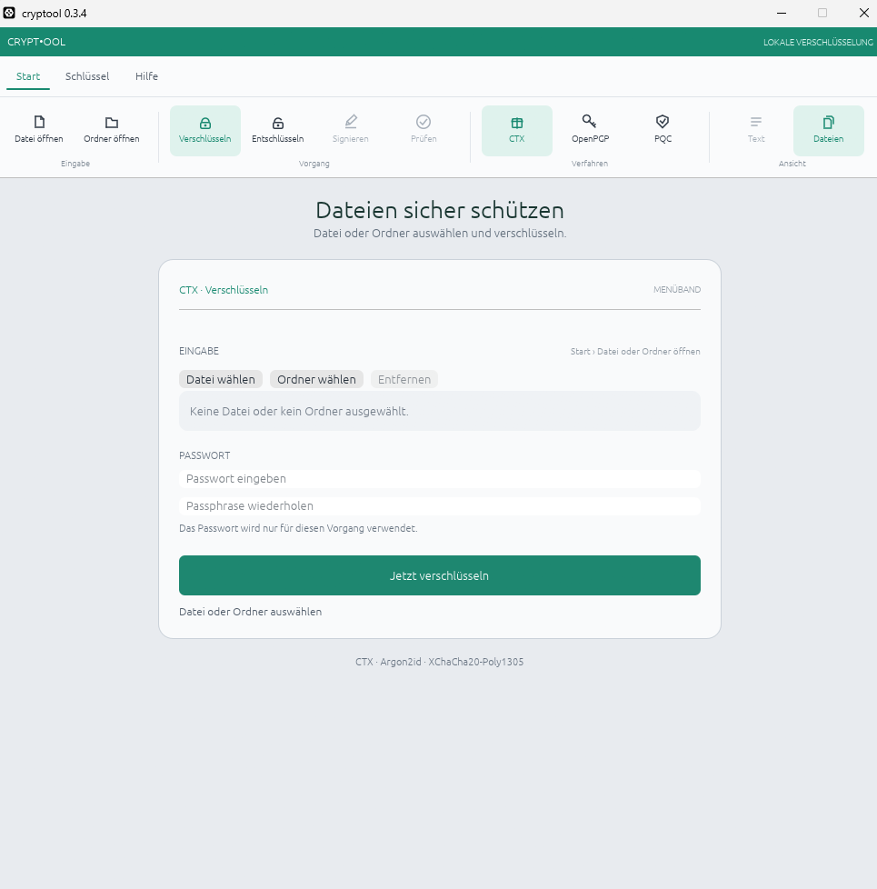

# cryptool

cryptool verschlüsselt und entschlüsselt Dateien, Ordner und Text direkt auf
deinem Rechner. Die grafische Oberfläche unterstützt drei Verfahren:

| Verfahren | Verwendung | Schlüssel oder Passwort |
| --- | --- | --- |
| **CTX** | Dateien und Ordner mit einem Passwort schützen | Passwort |
| **OpenPGP** | Mit anderen OpenPGP-Programmen Schlüssel und Dateien austauschen | Öffentlicher und geheimer Schlüssel |
| **PQC** | Verschlüsselung und Signaturen mit Post-Quantum-Schlüsseln ausprobieren | Öffentlicher und geheimer Schlüssel |

## cryptool starten

Lade die passende cryptool-Version von den [GitHub Releases](https://github.com/wiederda/cryptool/releases) herunter. Unter Windows kannst du das Archiv entpacken und `cryptool.exe` starten. Eine Installation ist nicht erforderlich.

## Dateien und Ordner verschlüsseln

1. Wähle im Menüband das Verfahren **CTX**, **OpenPGP** oder **PQC**.
2. Wähle den Vorgang **Verschlüsseln** oder **Entschlüsseln**.
3. Öffne eine Datei oder – beim Verschlüsseln – einen Ordner.
4. Wähle den passenden Schlüssel oder gib bei CTX ein Passwort ein.
5. Klicke auf **Jetzt verschlüsseln** oder **Jetzt entschlüsseln**.

Beim Verschlüsseln mit OpenPGP oder PQC brauchst du den **öffentlichen Schlüssel** der Person, die die Datei öffnen soll. Zum Entschlüsseln brauchst du deinen **geheimen Schlüssel** und gegebenenfalls dessen Passphrase. CTX verwendet ein Passwort, das du der empfangenden Person sicher mitteilen musst.

Die Ausgabedatei wird neben der Eingabe angelegt. Vorhandene Dateien werden nicht stillschweigend überschrieben.

## Text verschlüsseln und entschlüsseln

OpenPGP und PQC können auch direkt mit Text arbeiten:

1. Wähle **OpenPGP** oder **PQC**.
2. Wähle im Menüband unter **Ansicht** die Option **Text**.
3. Wähle **Verschlüsseln** oder **Entschlüsseln** und gib den Text in das obere Feld ein.
4. Starte den Vorgang. Das Ergebnis erscheint darunter.

Mit dem Kopier-Button neben dem Ergebnis kannst du es in die Zwischenablage übernehmen. cryptool leert die Zwischenablage nach 60 Sekunden automatisch. Beim Wechsel zwischen Verfahren oder Vorgängen werden die Textfelder geleert; die Ansicht **Text** bleibt beim Wechsel zwischen OpenPGP und PQC ausgewählt.

CTX bietet keinen Textmodus.

## Schlüssel verwenden

Öffentliche Schlüssel kannst du in der Schlüsselverwaltung über **Importieren** hinzufügen. Gib einen Namen ein und wähle die Schlüsseldatei aus. Geheime Schlüssel werden ebenfalls importiert und lokal gemerkt; sie erscheinen nur bei Vorgängen, für die sie gebraucht werden.

Du kannst ein Schlüsselpaar in cryptool erzeugen:

1. Wähle **OpenPGP** oder **PQC**.
2. Öffne im Menüband **Schlüssel** und wähle **Erstellen**.
3. Gib die verlangten Angaben und eine Passphrase ein.
4. Wähle Speicherorte für die Schlüsseldateien.

Gib nur den **öffentlichen Schlüssel** weiter. Bewahre den geheimen Schlüssel und seine Passphrase sicher auf.

## Schlüsselserver

Über **Schlüssel → Keyserver** kannst du öffentliche OpenPGP- und PQC-Schlüssel abrufen. Wähle zuerst das gewünschte Verfahren aus; die Liste zeigt dann Schlüssel dieses Verfahrens an. Trage die Serveradresse ein und klicke auf **Abrufen**. Wähle anschließend einen Eintrag und importiere ihn.

Du kannst auf derselben Seite auch einen öffentlichen OpenPGP- oder PQC-Schlüssel hochladen. Dafür brauchst du einen Upload-Token aus der Verwaltung deines Keyservers. Füge den Token ein, wähle die öffentliche Schlüsseldatei und starte den Upload. Lade niemals einen geheimen Schlüssel hoch. Der Token wird nur vorübergehend in cryptool gespeichert und beim Verlassen der Keyserver-Seite gelöscht. Zu entfernten Keyservern sendet cryptool den Token nur über HTTPS.

Die zuletzt verwendete Serveradresse merkt sich cryptool für den nächsten Start. Wenn du keinen eigenen Server betreibst oder verwendest, kannst du diesen Bereich ignorieren.

## Signaturen

- **Signieren** erstellt eine Signatur für eine einzelne Datei. Ordner können nicht signiert werden.
- **Prüfen** benötigt die Originaldatei, die Signaturdatei und den öffentlichen Schlüssel der unterzeichnenden Person.
- Öffentliche Schlüssel müssen über einen vertrauenswürdigen Weg bezogen und dem richtigen Besitzer zugeordnet werden.

## Wichtige Hinweise

- Die Ver- und Entschlüsselung läuft lokal. Eine Netzwerkverbindung wird nur verwendet, wenn du den optionalen Keyserver aufrufst.
- OpenPGP ist für den Austausch mit OpenPGP-Programmen gedacht.
- PQC ist ein eigenes cryptool-Format und nicht mit OpenPGP kompatibel. Prüfe vor dem Austausch, ob die andere Person ebenfalls cryptool mit PQC verwendet.
- Bei PQC kann cryptool nicht selbst bestätigen, wem ein öffentlicher Schlüssel gehört. Vergleiche den Schlüssel über einen vertrauenswürdigen zweiten Kanal.
- Beim Verschlüsseln eines Ordners sollte die Ausgabedatei außerhalb des zu verschlüsselnden Ordners liegen.
