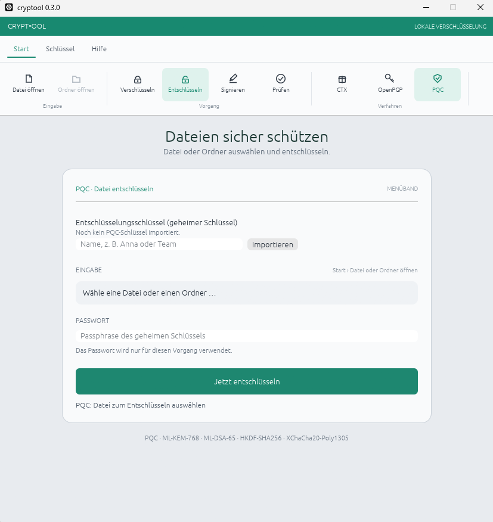

# cryptool

cryptool verschlüsselt und entschlüsselt Dateien, Ordner und Text **lokal** auf
deinem Rechner. Es gibt eine grafische Oberfläche (`cryptool-gui`) und ein
Kommandozeilenprogramm (`cryptool`). Beide nutzen dieselbe Bibliothek.

Es stehen drei Verfahren zur Auswahl:

| Verfahren | Wofür? | Schlüssel nötig? |
| --- | --- | --- |
| **CTX** | Einfache Verschlüsselung mit einem Passwort | Nein |
| **OpenPGP** | Verschlüsselung und Signaturen, kompatibel zu OpenPGP | Ja, öffentlich/privat |
| **PQC** | Verschlüsselung und Signaturen mit Post-Quantum-Verfahren | Ja, öffentlich/privat |

> **Kurzentscheidung:** Nur ein Passwort verwenden? → CTX. Mit anderer
> OpenPGP-Software austauschen? → OpenPGP. Post-Quantum-Schutz testen? → PQC.



---

## Installation

Lade die aktuelle Version von den
[GitHub Releases](https://github.com/wiederda/cryptool/releases) herunter.
Unter Windows enthält das Archiv `cryptool-gui.exe` für die Oberfläche und
`cryptool.exe` für die Kommandozeile. Eine Installation ist nicht nötig:
Archiv entpacken und die gewünschte Anwendung starten.

---

## GUI verwenden

### So gehst du vor

1. **Verfahren wählen** – im Menüband unter „Verfahren“: CTX, OpenPGP oder PQC.
2. **Vorgang wählen** – „Verschlüsseln“, „Entschlüsseln“, „Signieren“ oder
   „Prüfen“.
3. **Eingabe wählen** – Datei, Ordner oder (bei OpenPGP/PQC) Text.
4. **Schlüssel bzw. Passwort** – je nach Vorgang:
   - **Verschlüsseln:** öffentlicher Schlüssel des Empfängers
   - **Entschlüsseln:** eigener geheimer Schlüssel
   - **Signieren:** eigener geheimer Schlüssel
   - **Prüfen:** öffentlicher Schlüssel des Unterzeichners + Signaturdatei
   - **CTX:** nur ein Passwort
5. **Starten** – Fortschritt wird angezeigt, „Abbrechen“ bricht sauber ab.

### Schlüssel in der GUI

Öffentliche Schlüssel importierst du direkt im Hauptfenster:

1. Namen eingeben (z. B. „Anna“).
2. Auf „Importieren“ klicken und die Schlüsseldatei auswählen.
3. Der Schlüssel erscheint danach in der Auswahlliste.

Geheime Schlüssel werden genauso importiert, aber nur bei „Entschlüsseln“ und
„Signieren“ angeboten. Sie werden lokal gemerkt und können beim nächsten Start
wieder aus der Liste gewählt werden.

Ablageorte (Windows):

```text
%APPDATA%\cryptool\recipient-keys\   öffentliche Empfängerschlüssel
%APPDATA%\cryptool\secret-keys\      gemerkte geheime Schlüssel
```

Unter Linux/macOS liegen die Dateien im jeweiligen Benutzer-Konfigurationsordner
unter `cryptool/`.

> Geheime Schlüssel bleiben durch ihre Passphrase geschützt. Schütze trotzdem
> den Benutzerordner und gib geheime Schlüssel niemals weiter.

### Schlüsselpaar in der GUI erzeugen

1. Verfahren **OpenPGP** oder **PQC** wählen.
2. Menüband „Schlüssel“ → „Erstellen“.
3. Nutzerkennung und Passphrase eingeben.
4. Speicherort für den geheimen und den öffentlichen Schlüssel wählen.

Danach kannst du den öffentlichen Schlüssel weitergeben und den geheimen
Schlüssel zum Entschlüsseln oder Signieren importieren.

### Textmodus

Bei OpenPGP und PQC gibt es unter „Ansicht“ den Modus „Text“. Dort kannst du
Text verschlüsseln oder entschlüsseln, ohne eine Datei anzulegen. Der
verschlüsselte Text wird als ASCII-Armor ausgegeben und kann direkt wieder in
das Textfeld eingefügt werden.

CTX unterstützt keinen Textmodus.

### Signieren und Prüfen

- **Signieren** erzeugt eine abgetrennte Signaturdatei zur ausgewählten Datei.
  Ordner werden nicht signiert.
- **Prüfen** benötigt die Originaldatei, die Signaturdatei und den öffentlichen
  Schlüssel des Unterzeichners.
- Wenn keine Signaturdatei gewählt wird, sucht cryptool automatisch nach der
  passenden Standarddatei (z. B. `brief.txt.sig`).

---

## Selbst bauen (optional)

Voraussetzungen:

- Rust 1.88 oder neuer
- Unter Windows: MSVC Build Tools (werden für Rust und `zstd` benötigt)
- `zstd` bringt C-Code mit; ein C-Compiler ist daher erforderlich

Bauen:

```text
cargo build --release
```

Ergebnis:

```text
target/release/cryptool       (Windows: cryptool.exe)
target/release/cryptool-gui   (Windows: cryptool-gui.exe)
```

Tests ausführen:

```text
cargo test --workspace
```

Für Release-Archive und GitHub-Releases siehe `README-release.md`.

---

## Kommandozeile: Grundlagen

```text
cryptool --help
cryptool pgp --help
cryptool pqc --help
```

Allgemeine Optionen:

| Option | Bedeutung |
| --- | --- |
| `-o`, `--output DATEI` | Zielpfad festlegen |
| `-f`, `--force` | vorhandene Zieldatei überschreiben (Ordner nie) |
| `-q`, `--quiet` | keine Fortschrittsanzeige und keine Hinweise |
| `--armor` | ASCII-Armor statt Binärformat (nur OpenPGP/PQC) |

### CTX: Dateien und Ordner mit Passwort

```text
cryptool encrypt datei.txt
cryptool decrypt datei.txt.ctx

cryptool encrypt mein-ordner
cryptool decrypt mein-ordner.ctx

cryptool inspect mein-ordner.ctx
```

Standardziele:

- Verschlüsseln: `<eingabe>.ctx`
- Entschlüsseln: `<eingabe>` ohne `.ctx`
- Ordner werden als tar-Archiv gepackt und mit zstd komprimiert.

`inspect` zeigt den Header einer CTX-Datei an, ohne ein Passwort zu benötigen.

### OpenPGP

Schlüsselpaar erzeugen:

```text
cryptool pgp keygen "Anna Beispiel <anna@example.org>"
```

Standarddateien:

```text
schluessel.sec.asc   geheimer Schlüssel (sicher aufbewahren)
schluessel.pub.asc   öffentlicher Schlüssel (weitergeben)
```

Verschlüsseln und entschlüsseln:

```text
cryptool pgp encrypt brief.txt --recipient anna.pub.asc
cryptool pgp decrypt brief.txt.pgp --key anna.sec.asc
```

Mit ASCII-Armor:

```text
cryptool pgp encrypt brief.txt --recipient anna.pub.asc --armor
```

Signieren und prüfen:

```text
cryptool pgp sign brief.txt --key anna.sec.asc
cryptool pgp verify brief.txt --key anna.pub.asc
```

Standarddateien:

- Verschlüsseln: `<eingabe>.pgp` bzw. `<eingabe>.asc` mit `--armor`
- Entschlüsseln: Datei ohne `.pgp`/`.asc`; Ordnerarchive werden entpackt
- Signieren: `<eingabe>.sig` bzw. `<eingabe>.sig.asc` mit `--armor`
- Prüfen: `<eingabe>.sig` oder `<eingabe>.sig.asc`

### PQC (Post-Quantum)

PQC verwendet ML-KEM-768 zur Schlüsseleinigung, HKDF-SHA256 zur
Schlüsselableitung und XChaCha20-Poly1305 zur Verschlüsselung. Signaturen
verwenden ML-DSA-65.

Schlüsselpaar erzeugen:

```text
cryptool pqc keygen "Anna Beispiel <anna@example.org>"
```

Standarddateien:

```text
schluessel.sec.pqc   geheimer Schlüssel
schluessel.pub.pqc   öffentlicher Schlüssel
```

Verschlüsseln und entschlüsseln:

```text
cryptool pqc encrypt brief.txt --recipient anna.pub.pqc
cryptool pqc decrypt brief.txt.pqc --key anna.sec.pqc
```

Signieren und prüfen:

```text
cryptool pqc sign brief.txt --key anna.sec.pqc
cryptool pqc verify brief.txt --key anna.pub.pqc
```

Standarddateien:

- Verschlüsseln: `<eingabe>.pqc`
- Entschlüsseln: Datei ohne `.pqc`
- Signieren: `<eingabe>.pqc.sig` bzw. `<eingabe>.pqc.sig.asc` mit `--armor`
- Prüfen: `<eingabe>.pqc.sig` oder `<eingabe>.pqc.sig.asc`

> **Wichtig:** Alte PQC-Schlüssel im Format v1 können verschlüsseln und
> entschlüsseln, aber nicht signieren. Für Signaturen muss ein neues
> Schlüsselpaar erzeugt werden.

---

## Passwörter in Skripten

Ohne Terminal fragt cryptool nicht interaktiv nach einem Passwort. Für Skripte
gibt es deshalb:

```text
echo "mein-passwort" | cryptool encrypt x.bin --password-stdin
cryptool encrypt x.bin --password-file passwort.txt
cryptool encrypt x.bin --no-confirm
```

- `--password-stdin` liest die erste Zeile aus stdin.
- `--password-file DATEI` liest die erste Zeile aus einer Datei.
- `--no-confirm` überspringt beim interaktiven Verschlüsseln die Wiederholung.
- Beim Entschlüsseln und Signieren wird das Passwort nur einmal abgefragt.

> Passwörter nie als Kommandozeilenargument übergeben: Sie sind dort für andere
> Prozesse sichtbar.

### Exit-Codes

| Code | Bedeutung |
| --- | --- |
| `0` | erfolgreich |
| `1` | allgemeiner Fehler |
| `2` | Signatur ungültig |
| `3` | falsches Passwort oder beschädigte Datei |
| `130` | abgebrochen (z. B. Strg+C) |

---

## Dateiendungen im Überblick

| Verfahren | Verschlüsselt | Schlüssel | Signatur |
| --- | --- | --- | --- |
| CTX | `.ctx` | – | – |
| OpenPGP | `.pgp`, `.asc` | `.pub.asc`, `.sec.asc` | `.sig`, `.sig.asc` |
| PQC | `.pqc`, `.pqc.asc` | `.pub.pqc`, `.sec.pqc` | `.pqc.sig`, `.pqc.sig.asc` |

---

## Hinweise zu Ordnern

- Dateinamen und Ordnerstruktur stehen nur im verschlüsselten Teil.
- Symlinks und Sonderdateien werden nicht aufgenommen; cryptool weist am Ende
  darauf hin.
- Besitzer und Gruppe werden nicht gespeichert, die Änderungszeit schon.
- Die Zieldatei darf nicht im zu verschlüsselnden Ordner liegen.
- Vorhandene Ordner werden beim Entschlüsseln nie überschrieben.

---

## Sicherheit und Grenzen

- cryptool arbeitet lokal und baut keine Netzwerkverbindung auf.
- CTX nutzt Argon2id und XChaCha20-Poly1305.
- OpenPGP nutzt Ed25519 zur Signatur, X25519 zum Verschlüsseln und
  AES-256/OCB (SEIPD v2).
- PQC ist ein eigenständiges, versioniertes Format (`CTPQ` v1) und **nicht**
  RFC 9980. Es kombiniert genau ein KEM (ML-KEM-768) und ein DEM
  (XChaCha20-Poly1305).
- Bei PQC gibt es keine Selbstsignatur des Schlüssels. Die Echtheit eines
  öffentlichen PQC-Schlüssels muss über einen separaten, vertrauenswürdigen
  Kanal bestätigt werden.
- Die OpenPGP-Implementierung sollte vor produktivem Einsatz mit unabhängigen
  OpenPGP-Implementierungen und RFC-9580-Testfällen geprüft werden.

---

## Probleme lösen

| Meldung / Problem | Lösung |
| --- | --- |
| „Kein Terminal: Passwort bitte mit … übergeben“ | `--password-stdin` oder `--password-file` verwenden |
| „Ziel existiert bereits“ | `-f` bzw. `--force` verwenden (Ordner werden nie überschrieben) |
| Exit-Code `3` | Passwort prüfen oder Datei auf Beschädigung prüfen |
| Exit-Code `2` | Signatur ist ungültig: Datei, Signatur und öffentlichen Schlüssel prüfen |
| PQC-Signatur mit alter Schlüsseldatei | Neues PQC-Schlüsselpaar erzeugen (Format v2) |
| Schlüssel wird in der GUI nicht angeboten | Prüfen, ob das richtige Verfahren gewählt ist und der Schlüssel importiert wurde |
| Schlüssel passt nicht zum Verfahren | OpenPGP- und PQC-Schlüssel sind nicht austauschbar |

---

## Projektstruktur

```text
crates/core   kryptografische Bausteine (Argon2id, XChaCha20-Poly1305)
crates/lib    öffentliche API, Datei-/Ordnerabläufe, OpenPGP und PQC
crates/cli    Kommandozeilenprogramm `cryptool`
crates/gui    Desktop-Oberfläche `cryptool-gui` (egui)
```

Weitere technische Details stehen in `ARCHITECTURE.md`.
